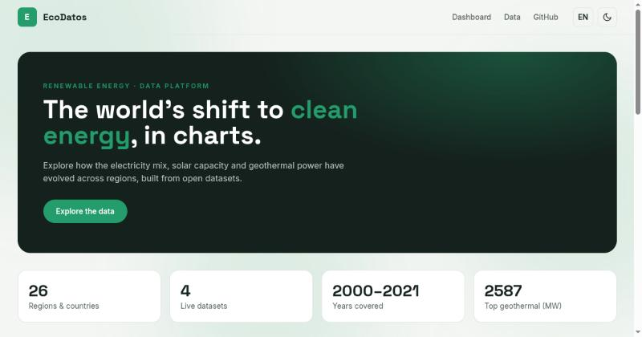
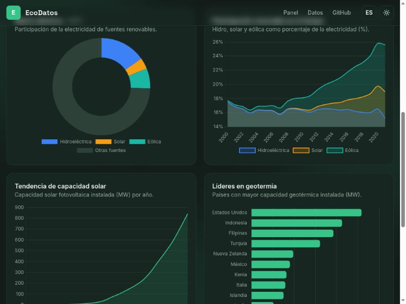

# EcoDatos

A renewable-energy data dashboard. Pick a region and explore its electricity mix, how the hydro/solar/wind share has changed over time, its solar capacity trend, and a global ranking of geothermal leaders — all rendered with Chart.js from open datasets, in English or Spanish and light or dark.

**Live demo:** [sagudelo01.github.io/Proyecto-Bootcamp](https://sagudelo01.github.io/Proyecto-Bootcamp/)



## Features

- Region selector that updates the charts for 26 countries and regions
- Four interactive charts: electricity mix (doughnut), renewable share over time (stacked area), solar capacity trend (line) and geothermal leaders (bar)
- English / Spanish toggle that translates the whole interface, including chart labels and region names; the choice is remembered and defaults to the browser language
- Light / dark theme that the charts adapt to; it respects `prefers-color-scheme` and is remembered
- Subtle CSS-only animated background that pauses when the tab is hidden and respects `prefers-reduced-motion`
- Accessibility basics: skip link, labelled controls, focus styles, and a styled 404 page
- Data is pre-processed into a small JS bundle, so the dashboard loads instantly with no backend

## Stack

- HTML, CSS and vanilla JavaScript
- Tailwind CSS (CDN) and Chart.js
- Data from [Our World in Data](https://ourworldindata.org/energy)

## Running locally

The site is fully static. Clone it and serve the folder:

```bash
git clone https://github.com/Sagudelo01/Proyecto-Bootcamp.git
cd Proyecto-Bootcamp
python3 -m http.server 8000
```

Then open `http://localhost:8000`.

## Data

The original project shipped several raw CSV datasets. They are filtered to a
set of key regions and converted into `js/data.js` (electricity mix, solar PV
capacity and installed geothermal capacity), which keeps the payload small and
avoids runtime CSV parsing.

## Screenshots

| Charts (light) | Charts (dark, Spanish) |
|---|---|
|  |  |
