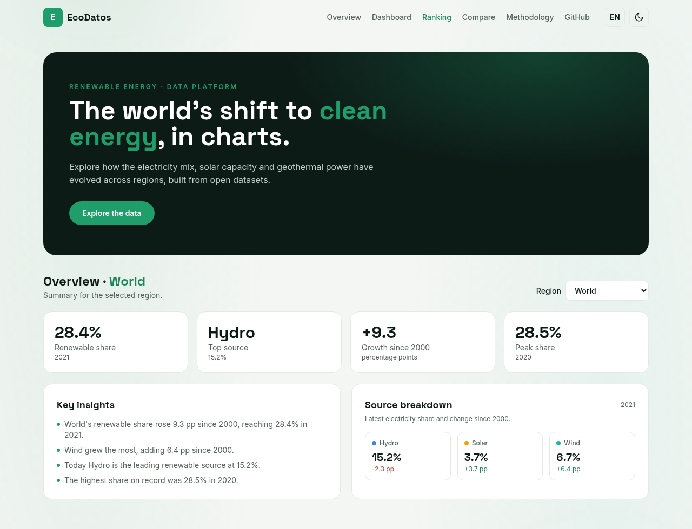
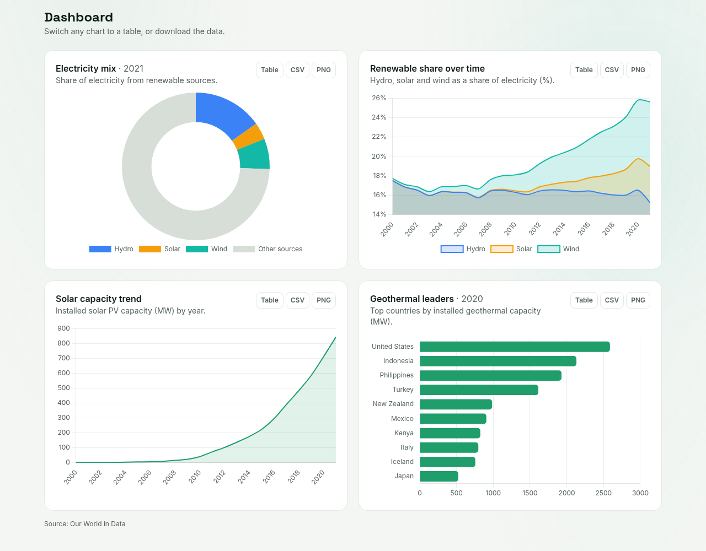
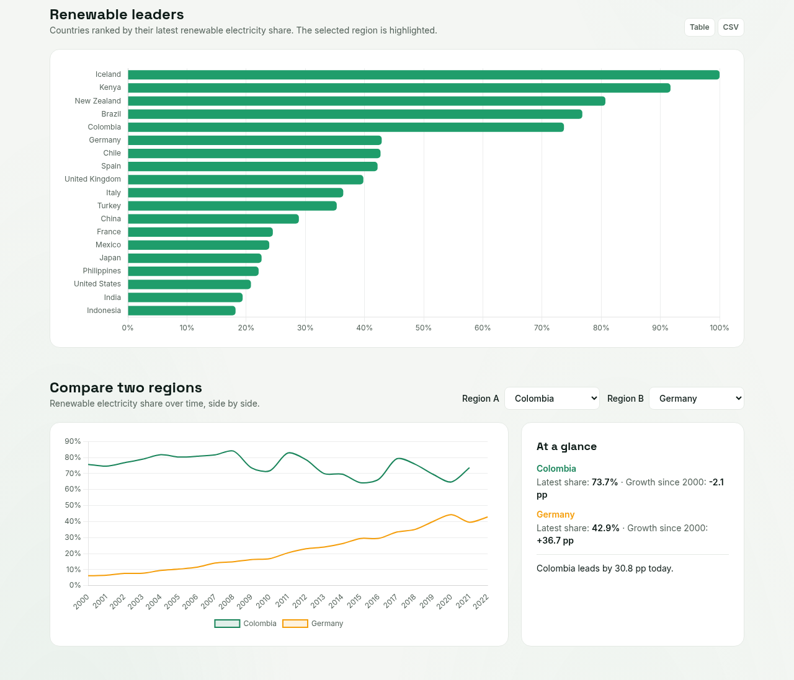

# EcoDatos

A renewable-energy data dashboard. Pick a region and explore its electricity mix, how the hydro/solar/wind share has changed over time, its solar capacity trend, and a global ranking of geothermal leaders — all rendered with Chart.js from open datasets, in English or Spanish and light or dark.

**Live demo:** [sagudelo01.github.io/Proyecto-Bootcamp](https://sagudelo01.github.io/Proyecto-Bootcamp/)



## Features

- Region selector that drives the whole dashboard for 26 countries and regions
- Summary KPI cards that recompute per region (renewable share, top source, growth since 2000, peak share) with a count-up that respects reduced-motion
- Automatic text insights per region: growth since 2000, the fastest-growing source, the current leading source and the all-time peak
- Source breakdown tiles showing the latest hydro, solar and wind share and each one's change since 2000
- A country ranking by latest renewable share, with the selected region highlighted
- A two-region comparator: renewable share over time side by side, with an at-a-glance summary of each region and the gap between them
- Four interactive charts: electricity mix (doughnut), renewable share over time (stacked area), solar capacity trend (line) and geothermal leaders (bar)
- Charts and the ranking can switch to an accessible data table, or export their data as CSV; charts also export as PNG
- English / Spanish toggle that translates the whole interface, including chart labels, table headers and region names; remembered and defaulting to the browser language
- Light / dark theme that the charts adapt to; respects `prefers-color-scheme` and is remembered
- Subtle CSS-only mesh background that drifts slowly, pauses when the tab is hidden and respects `prefers-reduced-motion`
- Sticky navigation with active-section highlighting, a styled 404 page, print styles, and keyboard shortcuts (`t` theme, `l` language)
- Methodology section citing the data, its limitations and an update note, plus a glossary of terms
- Data is pre-processed into a small JS bundle, so the dashboard loads instantly with no backend

## Stack

- HTML, CSS and vanilla JavaScript
- Tailwind CSS (compiled to a static stylesheet) and Chart.js
- Data from [Our World in Data](https://ourworldindata.org/energy)

## Running locally

The site is fully static. Clone it and serve the folder:

```bash
git clone https://github.com/Sagudelo01/Proyecto-Bootcamp.git
cd Proyecto-Bootcamp
python3 -m http.server 8000
```

Then open `http://localhost:8000`.

To rebuild the Tailwind stylesheet after changing classes:

```bash
npm install
npm run build:css
```

## Data

The original project shipped several raw CSV datasets. They are filtered to a
set of key regions and converted into `js/data.js` (electricity mix, solar PV
capacity and installed geothermal capacity), which keeps the payload small and
avoids runtime CSV parsing.

## Screenshots




